# AKSA FIGMA INTERACTIVE PROTOTYPE CONNECTION GUIDE

This document instructs our design team and teaching assistant on how to wire the Android screenshots into an interactive Figma prototype. It details user paths, hotspots, interaction triggers, feedback branches, and distinguishes native Android capabilities from Figma simulation techniques.

---

## 1. Prototype Structure Overview

```mermaid
flowchart TD
    Splash[01 Splash Screen] -->|After Delay 1200ms| Login[02 Login Screen]
    Login -->|Tap 'Masuk Mode Demo'| Home[05 Home Screen]
    Home -->|Tap 'Mulai Belajar'| Map[09 Level Map]
    Home -->|Tap Profile Tab| Profile[45 Profile Screen]
    Profile -->|Tap 'Pencapaian'| Badges[46 Progress & Badges]
    Profile -->|Tap '🛠️ Mode Dev Preview'| DevHub[48 Dev Preview Hub]

    subgraph Level 1: Pulau Alfabet
        Map -->|Tap Pulau Alfabet| AlphabetSelect[13 Alphabet Selection]
        AlphabetSelect -->|Tap 'A'| LetterIntroA[14 Letter Intro A]
        LetterIntroA -->|Tap 'Lanjut'| LetterIntroB[15 Letter Intro B]
        LetterIntroB -->|Tap 'Lanjut Kuis'| LetterQuiz[16 Letter Quiz]
        LetterQuiz -->|Tap Correct 'A'| LetterCorrect[17 Quiz Correct Feedback]
        LetterQuiz -->|Tap Incorrect 'B'| LetterIncorrect[18 Quiz Incorrect Feedback]
        LetterCorrect -->|Tap 'Lanjut'| LetterResult[19 Letter Session Result]
        LetterResult -->|Tap 'Ke Peta'| Map
        AlphabetSelect -->|Tap 'Huruf Mirip'| HurufMirip[20 Huruf Mirip Quiz]
        HurufMirip -->|Complete 10 Questions| HurufMiripResult[21 Huruf Mirip Result]
        HurufMiripResult -->|Tap 'Ke Peta'| Map
    end

    subgraph Level 2: Dunia Suku Kata
        Map -->|Tap Dunia Suku Kata| SukuIntro[22 Syllable Intro]
        SukuIntro -->|Tap 'Mulai'| SukuExample[23 Syllable Example]
        SukuExample -->|Tap 'Mulai Kuis'| SukuQuiz[24 Syllable Quiz Q1]
        SukuQuiz -->|Tap 'MA' then 'TA'| SukuCorrect[25 Syllable Correct Feedback]
        SukuQuiz -->|Tap Incorrect| SukuIncorrect[26 Syllable Incorrect Feedback]
        SukuCorrect -->|Complete 5 Words| SukuResult[27 Syllable Session Result]
        SukuResult -->|Tap 'Ke Peta'| Map
    end

    subgraph Level 3: Gunung Kata
        Map -->|Tap Gunung Kata| WordQuestion[28 Word Formation Q1]
        WordQuestion -->|Tap 'B' & 'O'| WordPartial[29 Word Partially Filled]
        WordPartial -->|Tap 'L' & 'A'| WordCorrect[30 Word Correct Feedback]
        WordPartial -->|Tap Wrong Letter| WordIncorrect[31 Word Incorrect Feedback]
        WordCorrect -->|Complete 5 Words| WordResult[32 Word Session Result]
        WordResult -->|Tap 'Ke Peta'| Map
    end

    subgraph Level 4: Sungai Cerita
        Map -->|Tap Sungai Cerita| Story1[33 Story Reading Panel 1]
        Story1 -->|Tap 'Halaman Berikutnya'| Story2[34 Story Reading Panel 2]
        Story2 -->|Tap 'Halaman Berikutnya'| Story3[35 Story Reading Panel 3]
        Story3 -->|Tap 'Mulai Kuis'| StoryQ[36 Story Comprehension Q1]
        StoryQ -->|Tap Correct Option| StoryCorrect[37 Comprehension Correct]
        StoryQ -->|Tap Incorrect Option| StoryIncorrect[38 Comprehension Incorrect]
        StoryCorrect -->|Complete 3 Questions| StoryResult[39 Story Session Result]
        StoryResult -->|Tap 'Ke Peta'| Map
    end

    subgraph Mini-Game: Tangkap Huruf
        Map -->|Tap '🎮 Tangkap Huruf'| GameIntro[40 Mini-Game Instructions]
        GameIntro -->|Tap 'Mulai Main'| GamePlay[41 Mini-Game Round 1]
        GamePlay -->|Tap Target Letter| GameCatch[42 Bubble Pop & Catch]
        GameCatch -->|3 Consecutive Correct| GameLevelUp[43 Level Up Banner]
        GameCatch -->|Complete 15 Rounds| GameResult[44 Mini-Game Results]
        GameResult -->|Tap 'Ke Peta'| Map
    end
```

---

## 2. Step-by-Step Hotspot Connections in Figma

### Flow A: Onboarding & Home
1. **Starting Screen**: `01-splash-screen.png`.
   - **Interaction**: Trigger: `After Delay (1200ms)` -> Action: `Navigate to` -> Destination: `02-login-screen.png` (Animation: `Dissolve`, 300ms ease-out).
2. **Login Screen**: `02-login-screen.png`.
   - **Hotspot 1**: "Masuk Mode Demo" button (bottom pill).
     - Action: `Navigate to` -> `05-home-default.png` (Animation: `Smart Animate`, 350ms).
   - **Hotspot 2**: "Belum punya akun? Daftar di sini".
     - Action: `Navigate to` -> `03-register-screen.png` (Animation: `Push Left`, 350ms).
3. **Home Screen**: `05-home-default.png`.
   - **Hotspot 1**: Primary Action Button "Mulai Belajar" (Orange pill with play icon).
     - Action: `Navigate to` -> `09-level-map-default.png` (Animation: `Push Left`, 350ms).
   - **Hotspot 2**: Bottom Navigation: Profile icon.
     - Action: `Navigate to` -> `45-profile-screen.png` (Animation: `Dissolve`, 200ms).

---

### Flow B: Adventure Map Navigation
1. **Level Map**: `09-level-map-default.png`.
   - **Node 1 (Pulau Alfabet)**: Circular card labeled "Pulau Alfabet".
     - Action: `Navigate to` -> `13-alphabet-selection.png`.
   - **Node 2 (Dunia Suku Kata)**: Circular card labeled "Dunia Suku Kata".
     - Action: `Navigate to` -> `22-syllable-intro.png`.
   - **Node 3 (Gunung Kata)**:
     - *In standard progression*: Shows lock state.
     - *In prototype*: Hotspot connects to `28-word-formation-question.png`.
   - **Node 4 (Sungai Cerita)**:
     - Action: `Navigate to` -> `33-story-reading-panel-1.png`.
   - **Floating Quick-Launch Pill (Top-Left)**: "🎮 Tangkap Huruf".
     - Action: `Navigate to` -> `40-minigame-instructions.png`.
   - **Floating Dev Preview Pill (Top-Right)**: "🛠️ Dev Preview".
     - Action: `Navigate to` -> `48-developer-preview-hub.png`.
   - **Back Button (Top-Left Arrow)**:
     - Action: `Navigate to` -> `05-home-default.png` (Animation: `Push Right`, 350ms).

---

### Flow C: Level 1 — Pulau Alfabet & Huruf Mirip
1. **Alphabet Selection**: `13-alphabet-selection.png`.
   - **Hotspot 1**: Letter Card "A".
     - Action: `Navigate to` -> `14-letter-intro-a.png`.
   - **Hotspot 2**: "Latihan Huruf Mirip" Card.
     - Action: `Navigate to` -> `20-huruf-mirip-question.png`.
2. **Letter Intro**:
   - `14-letter-intro-a.png`: Tap "Lanjut" -> `15-letter-intro-b.png`.
   - `15-letter-intro-b.png`: Tap "Mulai Kuis Huruf" -> `16-letter-quiz-question.png`.
3. **Letter Quiz**:
   - `16-letter-quiz-question.png`:
     - Tap tile "A" (Correct): `Navigate to` -> `17-letter-quiz-feedback-correct.png`.
     - Tap tile "B" or "C" (Incorrect): `Navigate to` -> `18-letter-quiz-feedback-incorrect.png`.
4. **Quiz Feedback & Completion**:
   - From `17-letter-quiz-feedback-correct.png`: Tap "Pertanyaan Berikutnya" -> `19-letter-learning-result.png`.
   - From `19-letter-learning-result.png`: Tap "Selesai & Ke Peta" -> `09-level-map-default.png`.

---

### Flow D: Level 2 — Dunia Suku Kata
1. **Intro & Example**:
   - `22-syllable-intro.png`: Tap "Mulai Belajar" -> `23-syllable-example.png`.
   - `23-syllable-example.png`: Tap "Mulai Kuis Suku Kata" -> `24-syllable-quiz-question.png`.
2. **Syllable Construction Quiz**:
   - `24-syllable-quiz-question.png`:
     - Tap chips "MA" + "TA" (Target: MATA): `Navigate to` -> `25-syllable-quiz-feedback-correct.png`.
     - Tap chips "BU" + "KU" (Incorrect): `Navigate to` -> `26-syllable-quiz-feedback-incorrect.png`.
3. **Session Completion**:
   - From `25-syllable-quiz-feedback-correct.png`: Tap "Pertanyaan Berikutnya" -> `27-syllable-quiz-result.png`.
   - From `27-syllable-quiz-result.png`: Tap "Kembali ke Peta" -> `09-level-map-default.png`.

---

### Flow E: Level 3 — Gunung Kata
1. **Word Construction**:
   - `28-word-formation-question.png`:
     - Tap letter chip "B" or "O": `Navigate to` -> `29-word-formation-partially-filled.png`.
   - `29-word-formation-partially-filled.png`:
     - Tap "L" and "A": `Navigate to` -> `30-word-formation-feedback-correct.png`.
     - Tap wrong letter: `Navigate to` -> `31-word-formation-feedback-incorrect.png`.
2. **Word Session Completion**:
   - From `30-word-formation-feedback-correct.png`: Tap "Lanjut Kata Berikutnya" -> `32-word-formation-result.png`.
   - From `32-word-formation-result.png`: Tap "Kembali ke Peta" -> `09-level-map-default.png`.

---

### Flow F: Level 4 — Sungai Cerita
1. **Story Panels**:
   - `33-story-reading-panel-1.png`: Tap "Halaman Berikutnya" -> `34-story-reading-panel-2.png`.
   - `34-story-reading-panel-2.png`: Tap "Halaman Berikutnya" -> `35-story-reading-panel-3.png`.
   - `35-story-reading-panel-3.png`: Tap "Mulai Kuis Pemahaman Cerita" -> `36-story-comprehension-question.png`.
2. **Comprehension Assessment**:
   - `36-story-comprehension-question.png`:
     - Tap correct option ("Kancil yang cerdik"): `Navigate to` -> `37-story-comprehension-feedback-correct.png`.
     - Tap incorrect option: `Navigate to` -> `38-story-comprehension-feedback-incorrect.png`.
3. **Story Reading Completion**:
   - From `37-story-comprehension-feedback-correct.png`: Tap "Lihat Hasil Membaca" -> `39-story-reading-result.png`.
   - From `39-story-reading-result.png`: Tap "Kembali ke Petualangan" -> `09-level-map-default.png`.

---

### Flow G: Mini-Game Tangkap Huruf
1. **Entry & Instructions**:
   - `40-minigame-instructions.png`: Tap "Mulai Main!" -> `41-minigame-playing.png`.
2. **Gameplay Simulation**:
   - `41-minigame-playing.png`: Target prompt displays letter "[ M ]".
     - Tap the bubble containing letter "M": `Navigate to` -> `42-minigame-correct-catch.png` (Animation: `Smart Animate`, 200ms).
3. **Adaptive Level Up**:
   - `42-minigame-correct-catch.png`: Tap "Lanjut" (or After Delay 600ms) -> `43-minigame-adaptive-level-up.png`.
4. **Game Result**:
   - `43-minigame-adaptive-level-up.png`: Tap "Selesaikan Sesi" -> `44-minigame-results.png`.
   - `44-minigame-results.png`:
     - Tap "Main Lagi" -> `41-minigame-playing.png`.
     - Tap "Kembali ke Peta" -> `09-level-map-default.png`.

---

## 3. Comparison: Real Android vs Figma Prototype Simulation

| Feature / Interaction | Real Android App (Jetpack Compose) | Figma Interactive Prototype Simulation |
|---|---|---|
| **Text-to-Speech (TTS)** | Real Indonesian audio synthesis (`AndroidTextToSpeechHelper`) speaking letters, words, and stories | Visual speaker icon pulse (Optional audio clip embed in Figma interactive component) |
| **Letter Tracing / Slots** | Dynamic state lists, interactive slot clearing, animated layout transitions | Static screen branching: Empty Slots -> Partial Slots -> Filled Slots |
| **Falling Mini-Game** | Live Compose physics loop (60 FPS coroutine delay, lane collisions, randomized alphabet pool) | Sequential hotspot tapping on falling bubble screenshot |
| **Adaptive Difficulty** | Dynamic calculation: `3 correct -> +1 level`, `2 incorrect -> -1 level`, speed adjustment | Fixed branch showing Level 1 question followed by Level 2 advancement screen |
| **Weekly Activity Streak** | Real `SessionRepository` SQLite/Firestore logging tracking ISO weekdays and streaks | Injected visual state screenshots (`0/7`, `2/7`, `3/7`, `7/7` days active) |
| **Level Unlock Progression** | Unlocked based on session score and completed modules | Toggled using the Developer Preview Map state screenshots |
| **Micro-Animations** | Spring bouncing, floating mascot waves, pulsing buttons | Figma `Smart Animate` transition with Gentle Spring / Ease Out curves |
